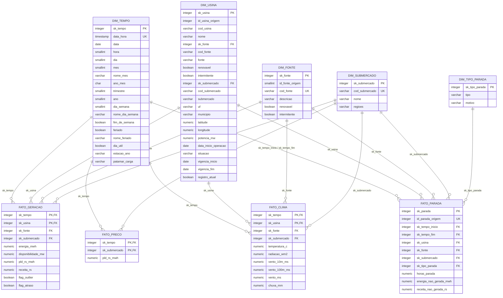

# Modelagem Dimensional — Data Warehouse (`dw_campo_real`)

**Etapa 3 · Responsável:** Nelson  
**Schema no PostgreSQL (Neon):** `dw_campo_real`  
**Scripts versionados:** `sql/03_dw_ddl.sql` (DDL) e `sql/04_dw_carga.sql` (Carga e Validações)

---

## 1. Objetivo

Transformar os dados limpos e validados na Etapa 2 (`schema qualidade`) em um **Data Warehouse dimensional em formato Star Schema** no schema `dw_campo_real`, projetado para responder com alto desempenho e simplicidade às perguntas de negócio da diretoria da **Campo Real Energia**:

> *"Quanto a nossa geração vale, onde e quando ganhamos ou perdemos dinheiro, e podemos confiar nos números que nos mostram?"*

O painel da Etapa 4 (Power BI / Tableau) conecta-se **exclusivamente** ao schema `dw_campo_real`, nunca às tabelas operacionais de origem (`campo_real_energia`).

---

## 2. Matriz de Barramento (Enterprise Bus Matrix)

A matriz de barramento relaciona os **4 processos de negócio** modelados (linhas) com as **5 dimensões conformadas** do Data Warehouse (colunas):

| Processo de Negócio | Tabela Fato no DW | `dim_tempo` | `dim_usina` | `dim_fonte` | `dim_submercado` | `dim_tipo_parada` |
|---|---|:---:|:---:|:---:|:---:|:---:|
| **1. Geração horária de energia** (`medicao_geracao_limpa`) | `fato_geracao` | **X** | **X** | **X** | **X** | |
| **2. Preço horário de mercado — PLD** (`pld_horario_limpo`) | `fato_preco` | **X** | | | **X** | |
| **3. Clima horário nas usinas** (`clima_horario_limpo`) | `fato_clima` | **X** | **X** | **X** | **X** | |
| **4. Paradas de usinas** (`parada_usina_limpa`) | `fato_parada` | **X** *(início e fim)* | **X** | **X** | **X** | **X** |

### Decisão de arquitetura sobre `dim_fonte` e `dim_submercado` (Star Schema puro vs. Snowflake)

No sistema operacional, `fonte_energia` e `submercado` chegam por meio do cadastro de `usina`. Porém, o fato de preço (`fato_preco`) ocorre no grão **submercado × hora** (não possui usina), exigindo que `dim_submercado` exista como dimensão conformada independente.

Para evitar *snowflaking* no painel e ao mesmo tempo facilitar consultas SQL diretas, adotou-se uma **abordagem dupla compatível**:
1. **Dimensões conformadas independentes (`dim_submercado` e `dim_fonte`)** ligadas diretamente às tabelas fato (`fato_geracao`, `fato_clima`, `fato_parada` e `fato_preco`) por meio das chaves substitutas `sk_submercado` e `sk_fonte`. No Power BI / Tableau, isso permite filtrar todas as tabelas fato em estrela pura (`1:N`, direção única) a partir de `dim_tempo`, `dim_submercado`, `dim_fonte` e `dim_usina`.
2. **Atributos achatados (desnormalizados) dentro de `dim_usina`** (`cod_fonte`, `fonte`, `renovavel`, `intermitente`, `cod_submercado`, `submercado`), permitindo que consultas simples que juntem apenas `fato_geracao` com `dim_usina` também tenham acesso imediato à fonte e ao submercado sem joins adicionais.

---

## 3. Declaração Formal de Grão das Tabelas Fato

Antes da criação de cada tabela fato em `sql/03_dw_ddl.sql`, seu grão foi formalmente declarado em uma frase:

| Tabela Fato | Declaração de Grão (`1 linha =`) | Chave Primária / Natural | Medidas (Fatos) | Chaves Estrangeiras (`sk_`) |
|---|---|---|---|---|
| **`fato_geracao`** | **1 linha = 1 usina em 1 hora.** | `(sk_tempo, sk_usina)` | `energia_mwh`, `disponibilidade_mw`, `pld_rs_mwh`*, `receita_rs`* | `sk_tempo`, `sk_usina`, `sk_fonte`, `sk_submercado` |
| **`fato_preco`** | **1 linha = 1 submercado em 1 hora.** | `(sk_tempo, sk_submercado)` | `pld_rs_mwh` | `sk_tempo`, `sk_submercado` |
| **`fato_clima`** | **1 linha = 1 usina (ponto de clima) em 1 hora.** | `(sk_tempo, sk_usina)` | `temperatura_c`, `radiacao_wm2`, `vento_10m_ms`, `vento_100m_ms`, `vento_ms`, `chuva_mm` | `sk_tempo`, `sk_usina`, `sk_fonte`, `sk_submercado` |
| **`fato_parada`** | **1 linha = 1 parada de 1 usina.** | `sk_parada` (`id_parada_origem` único) | `horas_parada`, `energia_nao_gerada_mwh`, `receita_nao_gerada_rs` | `sk_tempo_inicio`, `sk_tempo_fim`, `sk_usina`, `sk_fonte`, `sk_submercado`, `sk_tipo_parada` |

*\*Nota sobre o cálculo da **Receita Valorada** (`fato_geracao` × `fato_preco`):*
- `fato_geracao` (usina × hora) e `fato_preco` (submercado × hora) possuem granularidades diferentes.
- Mantemos `fato_preco` separada no grão `submercado × hora` (cobrindo 2025 e 2026) porque o PLD existe independentemente de haver geração medida em uma usina (essencial para responder à **Pergunta 4**: *"Em que horas e meses o PLD é mais alto, e nós geramos nesses momentos?"*).
- Adicionalmente, durante a carga de `fato_geracao`, fazemos o *lookup* em `fato_preco` por `(sk_tempo, sk_submercado)` e já armazenamos `pld_rs_mwh` e `receita_rs = round(energia_mwh * pld_rs_mwh, 2)` na própria linha de `fato_geracao` (além de disponibilizar a view `dw_campo_real.vw_geracao_analitica`). Assim, o painel pode tanto somar `receita_rs` diretamente quanto cruzar `fato_geracao` e `fato_preco` pelas dimensões conformadas `dim_tempo` e `dim_submercado`.

---

## 4. Diagrama do Star Schema (`dw_campo_real`)

---

## 5. Chaves Substitutas (`sk_`) e Membro "Desconhecido" (`sk = -1`)

Todas as dimensões utilizam chaves substitutas inteiras (`GENERATED BY DEFAULT AS IDENTITY`) independentes das chaves do sistema operacional. Para garantir integridade referencial caso algum fato chegue sem correspondência cadastral, todas as 5 dimensões possuem um **membro especial "Desconhecido" com `sk = -1`** criado no DDL (`OVERRIDING SYSTEM VALUE`), e todas as cargas de fatos utilizam `COALESCE(dim.sk_..., -1)`:

| Dimensão | Chave Substituta | Registro `sk = -1` (Membro Desconhecido) |
|---|---|---|
| `dim_tempo` | `sk_tempo = -1` | `data_hora = '1900-01-01 00:00:00'`, `nome_mes = 'Desconhecido'`, `estacao_ano = 'Desconhecido'`, `patamar_carga = 'Desconhecido'` |
| `dim_submercado` | `sk_submercado = -1` | `cod_submercado = 'ND'`, `nome = 'Desconhecido'`, `regioes = 'Desconhecido'` |
| `dim_fonte` | `sk_fonte = -1` | `cod_fonte = 'DESC'`, `descricao = 'Desconhecido'`, `renovavel = false`, `intermitente = false` |
| `dim_usina` | `sk_usina = -1` | `cod_usina = 'DESCONHECIDO'`, `nome = 'Desconhecido'`, `potencia_mw = 0.00`, `vigencia_inicio = '1900-01-01'`, `registro_atual = true` |
| `dim_tipo_parada` | `sk_tipo_parada = -1` | `tipo = 'Desconhecido'`, `motivo = 'Desconhecido'` |

---

## 6. Decisão de SCD (Slowly Changing Dimensions)

| Dimensão | Política de SCD | Justificativa Técnica e de Negócio |
|---|---|---|
| **`dim_usina`** | **SCD Tipo 2 (Híbrido com Tipo 1)** | **Tipo 2 (`potencia_mw`, `situacao`, `cod_fonte`, `cod_submercado`):** Se uma usina expandir sua potência instalada (ex.: adição de unidades geradoras) ou mudar de situação operacional, o cálculo do **fator de capacidade** ($\text{energia} \div (\text{potência} \times \text{horas})$) de meses anteriores precisa usar a potência vigente na época do fato, e não a potência nova. Por isso, alterações nesses atributos fecham o registro atual (`vigencia_fim = current_date - 1`, `registro_atual = false`) e abrem uma nova linha com novo `sk_usina` e `registro_atual = true`. **Tipo 1 (`nome`, `uf`, `municipio`, `latitude`, `longitude`):** Alterações nesses campos representam correções de erro de cadastro/digitação (como o sinal da latitude de `CRE-UFV-004` e a UF `SP` de `CRE-BIO-005` corrigidos na Etapa 2) e devem sobrescrever o registro atual sem abrir nova versão histórica. **Cuidado especial com `CRE-UFV-006`:** Na origem, a usina `CRE-UFV-006` possui `data_inicio_operacao = 2031-02-01` (sinalizada na Etapa 2 com `flag_inicio_operacao_invalido = true`, pois a usina operou durante todo o ano de 2025). Conforme documentado na Etapa 2 (`decisoes.py`), essa data inválida não deve bloquear a vigência de 2025; por isso, para `vigencia_inicio` do SCD Tipo 2, adota-se `'2025-01-01'` quando a flag está ativa, preservando `data_inicio_operacao` apenas como coluna informativa. |
| **`dim_tempo`** | **Tipo 0 (Estática)** | Construída deterministicamente via `generate_series` para todas as 17.520 horas de 2025 e 2026. Caso a tabela `feriado_nacional` receba os feriados de 2026 no futuro, o `ON CONFLICT (data_hora) DO UPDATE` atualiza `feriado` e `dia_util`. |
| **`dim_submercado`** | **SCD Tipo 1** | Os 4 submercados do SIN (`SE`, `S`, `NE`, `N`) são divisões regulatórias estáveis da CCEE/ONS; eventuais ajustes de descrição são sobrescritos. |
| **`dim_fonte`** | **SCD Tipo 1** | Catálogo fixo das 6 fontes de geração (`UHE`, `PCH`, `UFV`, `EOL`, `BIO`, `UTE`); ajustes textuais são sobrescritos. |
| **`dim_tipo_parada`** | **SCD Tipo 1** | Catálogo descritivo de tipo (`Programada` / `Forçada`) e motivo da parada. |

---

## 7. Tratamento de Granularidades Diferentes, Regras de Calendário, Clima e Paradas

### 7.1 Granularidades diferentes
- **Dados horários (`fato_geracao`, `fato_preco`, `fato_clima`):** ligam-se diretamente à `dim_tempo` no grão hora (`sk_tempo`).
- **Dados diários (`feriado_nacional`):** a tabela operacional `campo_real_energia.feriado_nacional` tem grão diário (13 datas em 2025, entre feriados nacionais e pontos facultativos). Na construção da `dim_tempo`, todas as 24 horas de uma data herdam os indicadores `feriado`, `nome_feriado`, `tipo_feriado` e `dia_util`. **Limitação documentada:** como `feriado_nacional` possui apenas o calendário de 2025, para o ano de 2026 o atributo `dia_util` diferencia apenas dias de semana (segunda a sexta) de fins de semana (sábado e domingo).
- **Dados cadastrais (`usina`, `fonte_energia`, `submercado`):** viram dimensões; as tabelas fato armazenam apenas as chaves substitutas (`sk_usina`, `sk_fonte`, `sk_submercado`).

### 7.2 Regras da `dim_tempo`: Estações do Ano e Patamares de Carga
- **Estações do ano (`estacao_ano` — Hemisfério Sul):**
  - **Verão:** 21/dez a 20/mar
  - **Outono:** 21/mar a 20/jun
  - **Inverno:** 21/jun a 22/set
  - **Primavera:** 23/set a 20/dez
- **Patamar de carga (`patamar_carga` — regra CCEE/ONS):**
  - **Em dias úteis (`dia_util = true`):**
    - **Leve:** `00h` às `06h` (`hora BETWEEN 0 AND 6`)
    - **Média:** `07h` às `17h` e `21h` às `23h` (`hora BETWEEN 7 AND 17 OR hora BETWEEN 21 AND 23`)
    - **Pesada (Ponta):** `18h` às `20h` (`hora BETWEEN 18 AND 20`)
  - **Em fins de semana e feriados (`dia_util = false`):**
    - **Leve:** `00h` às `17h` e `22h` às `23h`
    - **Média:** `18h` às `21h` (horário noturno residencial, sem ponta industrial)

### 7.3 Associação Clima × Usina e Clima × Submercado
- **Clima × Usina (1 para 1):** Como a extração do Open-Meteo (Etapa 1) buscou o histórico meteorológico nas coordenadas geográficas exatas de cada usina, cada ponto de clima pertence diretamente a uma usina (`cod_usina`). Assim, `fato_clima` relaciona-se `1:1` em cada hora com `dim_usina` (`PRIMARY KEY (sk_tempo, sk_usina)`).
- **Variáveis de vento em `fato_clima`:** A extração trouxe `vento_10m_ms` (10 m) e `vento_100m_ms` (100 m, altura do rotor eólico). Mantivemos ambas em `fato_clima` e adicionamos também a coluna `vento_ms` preenchida com `vento_100m_ms` para total compatibilidade com o modelo sugerido no enunciado.
- **Clima × Submercado:** Como `fato_clima` também contém `sk_submercado` (e `sk_fonte`), qualquer análise de clima por submercado ou por fonte (ex.: radiação média nas solares do NE ou vento médio a 100 m nas eólicas do S/NE) pode ser agregada diretamente por média no painel.

### 7.4 Critério de Estimativa de Perdas nas Paradas (`fato_parada` — Pergunta 5)
- **Horas indisponíveis (`horas_parada`):** No banco de origem e na regra `geracao_durante_parada` da Etapa 2, o timestamp `fim` da parada é **inclusivo** (ex.: `2025-07-07 00:00` a `2025-07-13 23:00` compreende `168 horas` = 7 dias completos). Portanto, cada parada é expandida hora a hora via `generate_series(inicio, fim, interval '1 hour')`.
- **Energia estimada não gerada (`energia_nao_gerada_mwh`):** Para respeitar a física de cada fonte (especialmente usinas solares, que geram `0 MWh` à noite e têm pico entre `11h` e `15h`), calcula-se para cada usina o seu **perfil horário típico** (`media_energia_mwh` da própria usina em cada hora do dia `0..23`, considerando todas as horas limpas de 2025 em que a usina **não** estava em parada). A energia não gerada na parada é a soma dessa geração típica para cada hora contida no intervalo `[inicio, fim]`.
- **Receita estimada não gerada (`receita_nao_gerada_rs`):** Para cada hora `t` da parada, multiplica-se a geração típica da usina naquela hora pelo `pld_rs_mwh` do submercado da usina na hora `t` (via `fato_preco`). Enquanto `fato_preco` estiver vazia devido ao bloqueio HTTP 403 da CCEE, a coluna permanece `NULL` (sem inventar preço) e passa a ser preenchida automaticamente assim que o PLD for carregado e `04_dw_carga.sql` for reexecutado.

---

## 8. Dicionário de Dados do Schema `dw_campo_real`

### 8.1 Tabelas do Star Schema (Dimensões e Fatos)

| Tabela | Tipo | Chave Primária | Principais Colunas | Descrição |
|---|---|---|---|---|
| `dim_tempo` | Dimensão | `sk_tempo` | `data_hora`, `data`, `hora`, `dia`, `mes`, `nome_mes`, `ano_mes`, `trimestre`, `ano`, `dia_semana`, `nome_dia_semana`, `fim_de_semana`, `feriado`, `nome_feriado`, `dia_util`, `estacao_ano`, `patamar_carga` | Calendário horário de 2025 e 2026 (17.520 horas + `sk = -1`). |
| `dim_submercado` | Dimensão | `sk_submercado` | `cod_submercado`, `nome`, `regioes` | Os 4 submercados do SIN (`N`, `NE`, `S`, `SE`) + `sk = -1`. |
| `dim_fonte` | Dimensão | `sk_fonte` | `id_fonte_origem`, `cod_fonte`, `descricao`, `renovavel`, `intermitente` | As 6 fontes de energia (`UHE`, `PCH`, `UFV`, `EOL`, `BIO`, `UTE`) + `sk = -1`. |
| `dim_usina` | Dimensão (SCD2) | `sk_usina` | `id_usina_origem`, `cod_usina`, `nome`, `sk_fonte`, `cod_fonte`, `fonte`, `renovavel`, `intermitente`, `sk_submercado`, `cod_submercado`, `submercado`, `uf`, `municipio`, `latitude`, `longitude`, `potencia_mw`, `data_inicio_operacao`, `situacao`, `vigencia_inicio`, `vigencia_fim`, `registro_atual` | Cadastro histórico das 9 usinas geradoras limpas + `sk = -1`. |
| `dim_tipo_parada` | Dimensão | `sk_tipo_parada` | `tipo`, `motivo` | Tipos (`Programada`, `Forçada`) e motivos das paradas + `sk = -1`. |
| `fato_geracao` | Fato | `(sk_tempo, sk_usina)` | `sk_fonte`, `sk_submercado`, `energia_mwh`, `disponibilidade_mw`, `pld_rs_mwh`, `receita_rs`, `flag_outlier`, `flag_atraso` | Geração e disponibilidade horária por usina (78.657 linhas limpas). |
| `fato_preco` | Fato | `(sk_tempo, sk_submercado)` | `pld_rs_mwh` | PLD horário (R$/MWh) por submercado (CCEE). |
| `fato_clima` | Fato | `(sk_tempo, sk_usina)` | `sk_fonte`, `sk_submercado`, `temperatura_c`, `radiacao_wm2`, `vento_10m_ms`, `vento_100m_ms`, `vento_ms`, `chuva_mm` | Variáveis meteorológicas horárias no ponto de cada usina (78.840 linhas). |
| `fato_parada` | Fato | `sk_parada` | `id_parada_origem`, `sk_tempo_inicio`, `sk_tempo_fim`, `sk_usina`, `sk_fonte`, `sk_submercado`, `sk_tipo_parada`, `horas_parada`, `energia_nao_gerada_mwh`, `receita_nao_gerada_rs` | Eventos de parada validados (10 paradas) com horas e perdas estimadas. |

### 8.2 Views Analíticas de Apoio ao Painel (Etapa 4)

Para garantir que o painel do Luiz (Etapa 4) conecte-se **apenas** ao schema `dw_campo_real` e ainda assim consiga responder também à **Pergunta 7** (*"Podemos confiar nesses números?"*), foram criadas 3 views no `dw_campo_real`:

1. **`dw_campo_real.vw_geracao_analitica`**: junta `fato_geracao`, `dim_tempo`, `dim_usina`, `dim_fonte`, `dim_submercado`, `fato_preco` e `fato_clima` em uma visão única pronta para exploração.
2. **`dw_campo_real.vw_qualidade_metricas`**: expõe as métricas de qualidade da última execução (`qualidade.metricas_qualidade` + `qualidade.decisoes`), já com o cálculo do `indice_qualidade_pct` ($100 - \text{percentual\_falha}$) e a classificação da camada (`Antes da limpeza (origem)`, `Fonte externa (extracao)` e `Depois da limpeza (qualidade)`).
3. **`dw_campo_real.vw_qualidade_antes_depois`**: expõe os indicadores de negócio antes e depois da limpeza (`geracao_mwh`, `fator_capacidade_pct`, `registros`, `receita_rs`) da última execução da Etapa 2.

---

## 9. Validações Executadas no Banco (`neondb`)

### 9.1 Contagem e Soma de Energia (`qualidade.medicao_geracao_limpa` vs. `dw_campo_real.fato_geracao`)

| Camada | Quantidade de Linhas | Soma de `energia_mwh` | Diferença | Status |
|---|---:|---:|---:|---|
| `qualidade.medicao_geracao_limpa` | 78.657 | 3.118.868,656 MWh | — | — |
| `dw_campo_real.fato_geracao` | 78.657 | 3.118.868,656 MWh | **0 linhas / 0,000 MWh** | **OK (100% idêntico)** |

### 9.2 Volumetria Geral e Integridade Referencial (`sk = -1`)

| Tabela no `dw_campo_real` | Total de Linhas | Linhas com `sk = -1` | Observação |
|---|---:|---:|---|
| `dim_tempo` | 17.521 | 1 | 17.520 horas (2025 e 2026) + 1 membro desconhecido |
| `dim_submercado` | 5 | 1 | 4 submercados + 1 membro desconhecido |
| `dim_fonte` | 7 | 1 | 6 fontes + 1 membro desconhecido |
| `dim_usina` | 10 | 1 | 9 usinas limpas + 1 membro desconhecido |
| `dim_tipo_parada` | 11 | 1 | 10 motivos de parada + 1 membro desconhecido |
| `fato_geracao` | 78.657 | **0** | 100% das medições limpas encontraram usina e hora válidas |
| `fato_clima` | 78.840 | **0** | 9 usinas × 8.760 horas de 2025 (100% mapeadas) |
| `fato_parada` | 10 | **0** | 10 paradas válidas (1 parada inválida ficou na quarentena da Etapa 2) |
| `fato_preco` | 0 | **0** | Pronta para carga assim que o bloqueio HTTP 403 da CCEE for liberado |

### 9.3 Conferência de Geração e Fator de Capacidade por Usina no DW (Pergunta 1)

| Código | Nome da Usina | Fonte | Submercado | Potência (MW) | Horas Medidas | Geração 2025 (MWh) | Fator de Capacidade (%) |
|---|---|---|---|---:|---:|---:|---:|
| `CRE-UHE-001` | UHE Campo Real Iguaçu | UHE | S | 180,00 | 8.760 | 972.675,073 | 61,69% |
| `CRE-UHE-008` | UHE Tocantins Real | UHE | N | 110,00 | 8.754 | 540.550,015 | 56,10% |
| `CRE-EOL-007` | EOL Ventos do Potiguar | EOL | NE | 120,00 | 8.760 | 493.796,457 | 46,97% |
| `CRE-UTE-009` | UTE Gás Norte | UTE | N | 150,00 | 8.756 | 380.879,902 | 28,99% |
| `CRE-BIO-005` | UTE Bagaço Campo Real | BIO | SE | 40,00 | 8.688 | 183.739,736 | 52,44% |
| `CRE-UFV-006` | UFV Sertão do Sol | UFV | NE | 90,00 | 8.756 | 168.751,198 | 21,40% |
| `CRE-EOL-003` | EOL Coxilha Real | EOL | S | 50,00 | 8.735 | 135.381,602 | 30,91% |
| `CRE-PCH-002` | PCH Rio das Araucárias | PCH | S | 25,00 | 8.760 | 130.789,903 | 59,72% |
| `CRE-UFV-004` | UFV Campo Real Minas | UFV | SE | 60,00 | 8.688 | 112.304,770 | 21,37% |
| **Total** | **9 Usinas Operacionais** | — | — | **825,00** | **78.657** | **3.118.868,656** | **43,16%** |

### 9.4 Conferência das Paradas e Energia Estimada Não Gerada no DW (Pergunta 5)

| ID | Usina | Fonte | Submercado | Tipo | Início | Fim | Horas Parada | Energia Não Gerada Estimada (MWh) |
|---:|---|---|---|---|---|---|---:|---:|
| 1 | `CRE-UHE-001` | UHE | S | Programada | 2025-07-07 00:00 | 2025-07-13 23:00 | 168,00 | 19.018,786 |
| 2 | `CRE-PCH-002` | PCH | S | Forçada | 2025-03-10 08:00 | 2025-03-11 17:00 | 34,00 | 509,490 |
| 3 | `CRE-EOL-003` | EOL | S | Programada | 2025-05-20 00:00 | 2025-05-22 23:00 | 72,00 | 1.125,234 |
| 4 | `CRE-UFV-004` | UFV | SE | Forçada | 2025-02-14 13:00 | 2025-02-14 18:00 | 6,00 | 134,759 |
| 5 | `CRE-BIO-005` | BIO | SE | Programada | 2025-12-01 00:00 | 2025-12-31 23:00 | 744,00 | 17.208,253 |
| 6 | `CRE-UFV-006` | UFV | NE | Forçada | 2025-10-02 09:00 | 2025-10-03 16:00 | 32,00 | 867,120 |
| 7 | `CRE-EOL-007` | EOL | NE | Forçada | 2025-09-08 05:00 | 2025-09-08 20:00 | 16,00 | 825,175 |
| 8 | `CRE-EOL-007` | EOL | NE | Programada | 2025-04-14 00:00 | 2025-04-17 23:00 | 96,00 | 5.480,572 |
| 9 | `CRE-UHE-008` | UHE | N | Programada | 2025-08-18 00:00 | 2025-08-24 23:00 | 168,00 | 10.577,290 |
| 10 | `CRE-UTE-009` | UTE | N | Programada | 2025-06-02 00:00 | 2025-06-15 23:00 | 336,00 | 15.191,791 |
| **Total** | **10 Paradas** | — | — | **6 Prog. / 4 Forç.** | — | — | **1.672,00** | **70.938,470** |

### 9.5 Teste Manual de Receita Valorada em 1 Hora

Para validar o relacionamento entre `fato_geracao`, `dim_tempo`, `dim_usina`, `dim_submercado` e o preço horário (`pld_rs_mwh`), executou-se o teste na hora `2025-07-15 19:00:00` (horário de ponta / patamar `Pesada`) para a usina `CRE-UHE-001` (Submercado `S`), utilizando o piso regulatório vigente da ANEEL para 2025 (`R$ 58,60/MWh`) caso `fato_preco` esteja vazia:

$$\text{Receita Hora} = 105{,}091\text{ MWh} \times \text{R\$ } 58{,}60/\text{MWh} = \text{R\$ } 6.158{,}33$$

O resultado retornado pela consulta de validação ao final de `sql/04_dw_carga.sql` é exatamente **`R$ 6.158,33`**.

